# 🏦 Banking System - Microservices với Docker

Bài tập **MD05 - Session 06**: xây dựng một hệ thống ngân hàng theo kiến trúc Microservices, đóng gói và vận hành bằng Docker Compose. Hệ thống được phát triển qua 6 bài, từ một ứng dụng đơn chạy cùng database đến một monorepo hoàn chỉnh có API Gateway, mạng nội bộ cô lập và script khởi chạy tự động.

## Mục lục

- [Kiến trúc](#kiến-trúc)
- [Công nghệ sử dụng](#công-nghệ-sử-dụng)
- [Cấu trúc thư mục](#cấu-trúc-thư-mục)
- [Khởi chạy nhanh](#khởi-chạy-nhanh)
- [Danh sách API](#danh-sách-api)
- [Bảo mật port và thứ tự khởi động](#bảo-mật-port-và-thứ-tự-khởi-động)
- [Nội dung từng bài](#nội-dung-từng-bài)
- [Vận hành](#vận-hành)

## Kiến trúc

```
                    Client (Postman / Mobile app)
                               │  http://localhost/api/v1/...  (port 80)
                               ▼
                     ┌───────────────────┐
                     │    api-gateway    │  Spring Cloud Gateway
                     └─────────┬─────────┘
          /api/v1/accounts/**  │  /api/v1/transactions/**
              ┌────────────────┴────────────────┐
              ▼                                 ▼
   ┌─────────────────────┐   OpenFeign   ┌─────────────────────┐
   │   account-service   │◄──────────────│ transaction-service │
   │        :8080        │               │        :8080        │
   └──────────┬──────────┘               └──────────┬──────────┘
              └────────────────┬────────────────────┘
                               ▼
                     ┌───────────────────┐
                     │  core-db (PG 15)  │  volume: pg-data
                     └───────────────────┘
                 ── banking-network (không mở port ra host) ──
```

| Service | Vai trò |
|---|---|
| **api-gateway** | Cổng vào duy nhất (Single Point of Entry). Định tuyến request tới service phù hợp và gắn `X-Request-Id` để truy vết. |
| **account-service** | Tạo và tra cứu tài khoản ngân hàng, cập nhật số dư khi chuyển tiền (khóa dòng để không sai số dư khi nhiều giao dịch chạy đồng thời). |
| **transaction-service** | Xử lý chuyển tiền. Gọi đồng bộ sang account-service bằng OpenFeign để kiểm tra tài khoản, rồi ghi lịch sử giao dịch. |
| **core-db** | PostgreSQL 15, dữ liệu lưu trong named volume `pg-data`. |

## Công nghệ sử dụng

- **Java 17**, **Gradle**
- **Spring Boot** 4.1 (account-service), 4.0 (transaction-service, api-gateway)
- **Spring Data JPA**, **Bean Validation**, **Spring Boot Actuator**
- **Spring Cloud OpenFeign** - gọi HTTP đồng bộ giữa các service
- **Spring Cloud Gateway** (WebFlux) - API Gateway
- **PostgreSQL 15**
- **Docker**, **Docker Compose** (multi-stage build, healthcheck, custom network, named volume)
- **Postman** - kiểm thử API

## Cấu trúc thư mục

```
.
├── docker-compose.yml          # File compose tổng: build/run toàn hệ thống (Bài 6)
├── docker-compose-bai1..5.yml  # File compose của từng bài trung gian
├── run.sh                      # Script khởi chạy bằng 1 lệnh
├── .env.example                # Mẫu biến môi trường (copy thành .env)
├── settings.gradle             # Gom 3 service để mở chung trong IDE
├── account-service/            # Quản lý tài khoản
├── transaction-service/        # Chuyển tiền
├── api-gateway/                # API Gateway
├── postman/                    # Postman collections
└── screenshots/bai1..bai6/     # Ảnh minh chứng kết quả từng bài
```

Mỗi service là một project Gradle độc lập, có `Dockerfile` multi-stage riêng. Docker tự build file JAR bên trong image, nên máy chạy **không cần cài JDK hay Gradle**.

## Khởi chạy nhanh

**Yêu cầu:** Docker Desktop đang chạy. Trên Windows, chạy lệnh trong **Git Bash** hoặc WSL (PowerShell không chạy được file `.sh`).

```bash
git clone https://github.com/Chuongpham2004/MD05_Session06_Homework.git
cd MD05_Session06_Homework

cp .env.example .env      # tạo file .env rồi điền giá trị thật
chmod +x run.sh
./run.sh
```

`run.sh` thực hiện:
1. Kiểm tra Docker đang chạy và đã có file `.env`.
2. Dọn dẹp container cũ (`docker compose down`). Dữ liệu trong volume `pg-data` **được giữ lại**.
3. Build image mới nhất và chạy ngầm (`docker compose up -d --build`).
4. Theo dõi và in ra thứ tự các service đạt trạng thái `healthy`. Script dừng và báo lỗi nếu có service bị restart hoặc `unhealthy`.

Khi script báo `[OK]`, hệ thống sẵn sàng tại **http://localhost/api/v1/...**

```bash
curl http://localhost/api/v1/accounts
```

## Danh sách API

Tất cả API được gọi qua Gateway tại `http://localhost` (port 80).

### Tài khoản → account-service

| Method | URL | Mô tả |
|---|---|---|
| POST | `/api/v1/accounts` | Tạo tài khoản mới |
| GET | `/api/v1/accounts` | Danh sách tài khoản |
| GET | `/api/v1/accounts/{id}` | Tài khoản theo id |
| GET | `/api/v1/accounts/number/{accountNumber}` | Tài khoản theo số tài khoản |

Ví dụ tạo tài khoản:

```json
POST /api/v1/accounts
{
  "ownerName": "Nguyen Van A",
  "email": "vana@example.com",
  "initialBalance": 1500000
}
```

### Giao dịch → transaction-service

| Method | URL | Mô tả |
|---|---|---|
| POST | `/api/v1/transactions/transfer` | Chuyển tiền |
| GET | `/api/v1/transactions` | Lịch sử giao dịch |
| GET | `/api/v1/transactions/{id}` | Giao dịch theo id |

Ví dụ chuyển tiền:

```json
POST /api/v1/transactions/transfer
{
  "sourceAccountNumber": "100056047123",
  "destinationAccountNumber": "100081384982",
  "amount": 500000,
  "description": "Chuyen tien"
}
```

### Mã lỗi

| HTTP | Khi nào |
|---|---|
| `400` | Dữ liệu gửi lên không hợp lệ (có chi tiết lỗi từng trường) |
| `404` | Không tìm thấy tài khoản / giao dịch, hoặc tài khoản nguồn không tồn tại |
| `409` | Email đã được dùng cho tài khoản khác |
| `422` | Vi phạm nghiệp vụ: không đủ số dư, tài khoản không ở trạng thái ACTIVE |
| `503` | transaction-service không kết nối được account-service |

Mọi giao dịch chuyển tiền, kể cả thất bại, đều được lưu lại với trạng thái `SUCCESS` hoặc `FAILED` để đối soát.

### Postman

| Collection | Dùng cho |
|---|---|
| [`Banking-API-Gateway.postman_collection.json`](postman/Banking-API-Gateway.postman_collection.json) | **Toàn bộ API qua Gateway** (Bài 5, 6) |
| [`Transaction-Service.postman_collection.json`](postman/Transaction-Service.postman_collection.json) | Gọi trực tiếp transaction-service ở cổng 8081 (Bài 4) |
| [`Account-Service.postman_collection.json`](postman/Account-Service.postman_collection.json) | Gọi trực tiếp account-service ở cổng 8080 (Bài 2) |

Import vào Postman rồi chạy **Run collection** theo thứ tự từ trên xuống. Các request đầu tự lưu số tài khoản và id vào biến của collection để các request sau dùng lại.

## Bảo mật port và thứ tự khởi động

Trong `docker-compose.yml`, **chỉ api-gateway mở port ra bên ngoài**:

| Service | Port trong mạng nội bộ | Port mở ra host |
|---|---|---|
| api-gateway | 8080 | **80** |
| account-service | 8080 | không có |
| transaction-service | 8080 | không có |
| core-db | 5432 | không có |

Thứ tự khởi động được kiểm soát bằng `depends_on` + `condition: service_healthy`:

```
core-db            (healthcheck: pg_isready)
   └─► account-service + transaction-service   (healthcheck: /actuator/health = UP)
          └─► api-gateway
```

`/actuator/health` chỉ báo `UP` khi service đã chạy **và** kết nối được database.

## Nội dung từng bài

### Bài 1 - Đóng gói ứng dụng và database bằng Docker Compose

- Chạy ứng dụng Spring Boot (`banking-app`) cùng PostgreSQL (`core-db`) bằng Docker Compose.
- Thông tin kết nối database đọc từ file `.env`, không viết thẳng vào compose.
- File: [`docker-compose-bai1.yml`](docker-compose-bai1.yml)

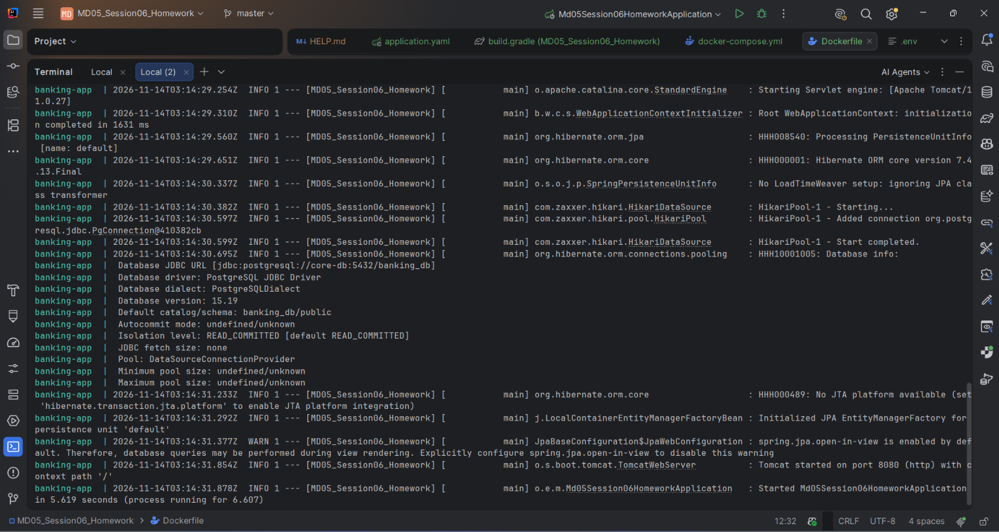

### Bài 2 - Account Service

- Đổi tên service thành `account-service`, viết REST API tạo và tra cứu tài khoản.
- Có kiểm tra dữ liệu đầu vào, số tài khoản 12 chữ số tự sinh, email không được trùng.
- Bảng `accounts` do Hibernate tự tạo trong `banking_db`.
- File: [`docker-compose-bai2.yml`](docker-compose-bai2.yml)

| Tạo tài khoản qua Postman | Kiểm tra dữ liệu trong database |
|---|---|
| 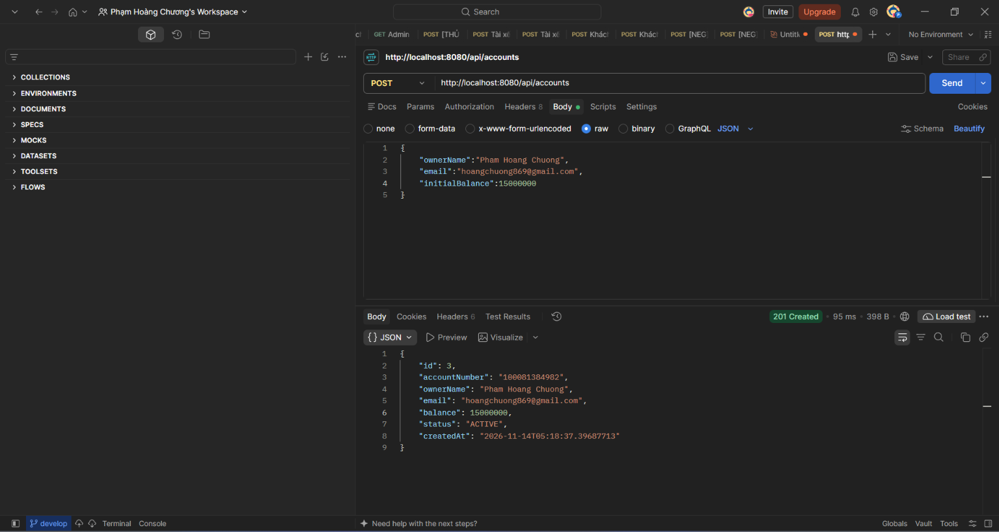 | 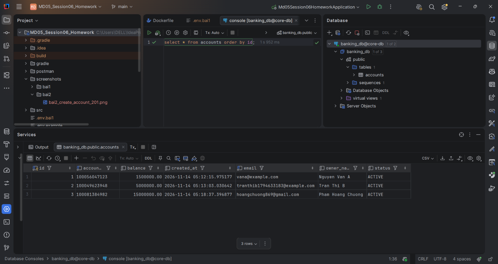 |

### Bài 3 - Dữ liệu bền vững và mạng nội bộ

- Tạo mạng nội bộ `banking-network` cho `core-db` và `account-service`.
- Bỏ map port `5432` của `core-db` ra máy host.
- Named volume `pg-data` mount vào `/var/lib/postgresql/data`, nên dữ liệu vẫn còn sau `docker compose down` rồi `up -d`.
- File: [`docker-compose-bai3.yml`](docker-compose-bai3.yml)

| down / up hệ thống | Dữ liệu vẫn còn sau khi khởi động lại |
|---|---|
| 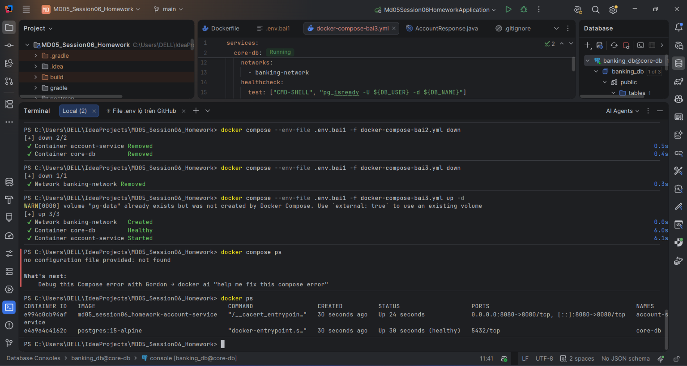 | 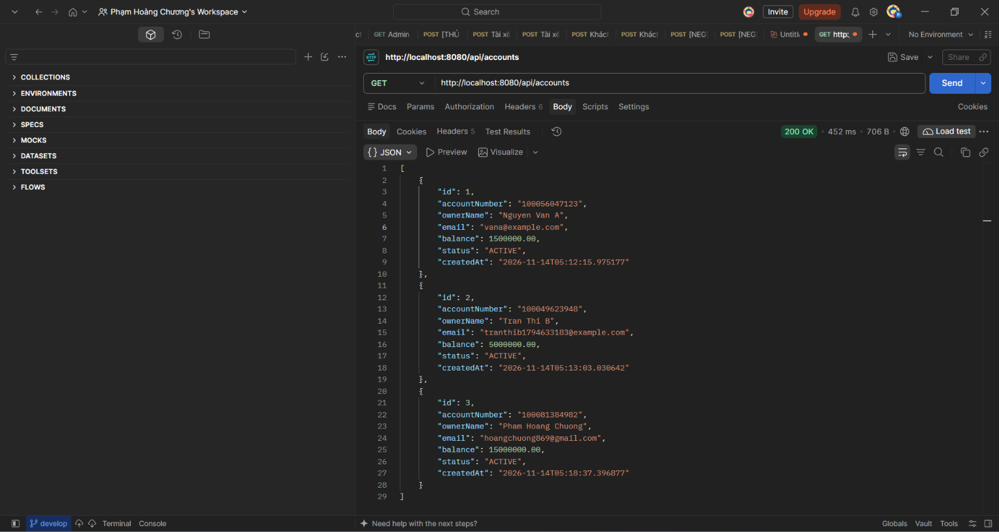 |

### Bài 4 - Giao tiếp giữa các service

- Thêm `transaction-service` (cổng host 8081), có Dockerfile riêng và cùng mạng `banking-network`.
- Gọi account-service bằng **OpenFeign** qua tên container `http://account-service:8080`, không dùng `localhost` hay IP.
- Luồng chuyển tiền: kiểm tra tài khoản nguồn → kiểm tra tài khoản đích → kiểm tra số dư → cập nhật số dư → lưu giao dịch.
- Header `X-Request-Id` được truyền qua Feign, nên log của cả 2 service in cùng một mã cho cùng một request.
- File: [`docker-compose-bai4.yml`](docker-compose-bai4.yml), code gọi liên service: [`AccountClient.java`](transaction-service/src/main/java/org/example/transactionservice/client/AccountClient.java)

| Code Feign client | Log 1 request chạy qua cả 2 service |
|---|---|
| 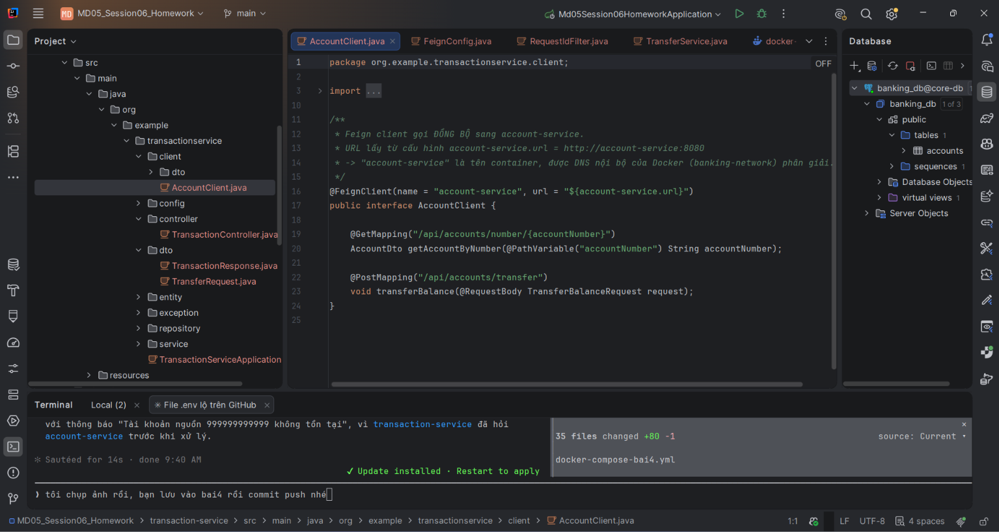 | 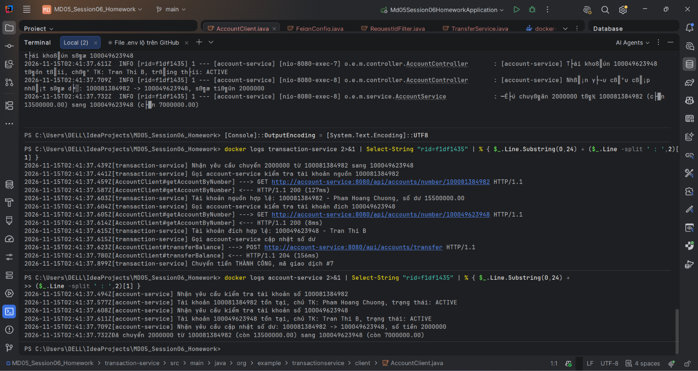 |

### Bài 5 - API Gateway

- Thêm `api-gateway` dùng Spring Cloud Gateway, map ra cổng **80** của host.
- `/api/v1/accounts/**` → `account-service:8080` và `/api/v1/transactions/**` → `transaction-service:8080`. Gateway đổi `/api/v1/...` thành `/api/...` trước khi chuyển tiếp.
- Header `Location` trả về từ service nội bộ được đổi thành đường dẫn công khai qua gateway, để không lộ địa chỉ bên trong.
- File: [`docker-compose-bai5.yml`](docker-compose-bai5.yml), cấu hình route: [`api-gateway/.../application.yml`](api-gateway/src/main/resources/application.yml)

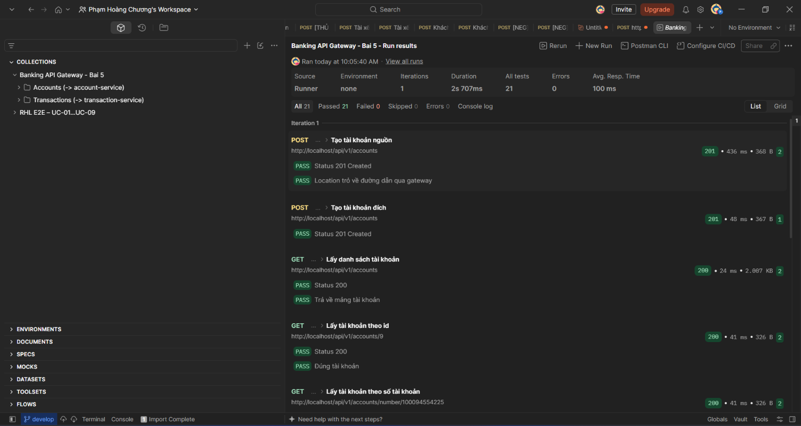

### Bài 6 - Đóng gói monorepo, bảo mật port, vận hành tự động

- Tổ chức dạng monorepo: mỗi service một thư mục con, một `docker-compose.yml` tổng ở thư mục gốc.
- Chỉ `api-gateway` mở port `80:8080`. Port 8080, 8081 và 5432 của các service nội bộ không mở ra ngoài.
- Thứ tự khởi động bằng `depends_on` + `service_healthy`.
- `run.sh` tự động dọn dẹp, build và khởi chạy toàn hệ thống.
- File: [`docker-compose.yml`](docker-compose.yml), [`run.sh`](run.sh)

| Chạy `./run.sh` | Các container lên `healthy` theo thứ tự |
|---|---|
| 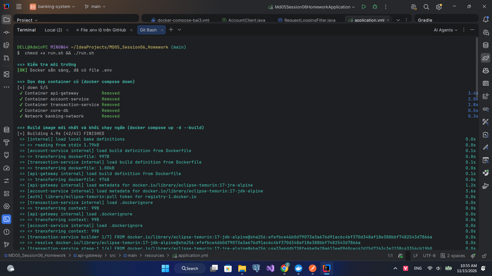 | 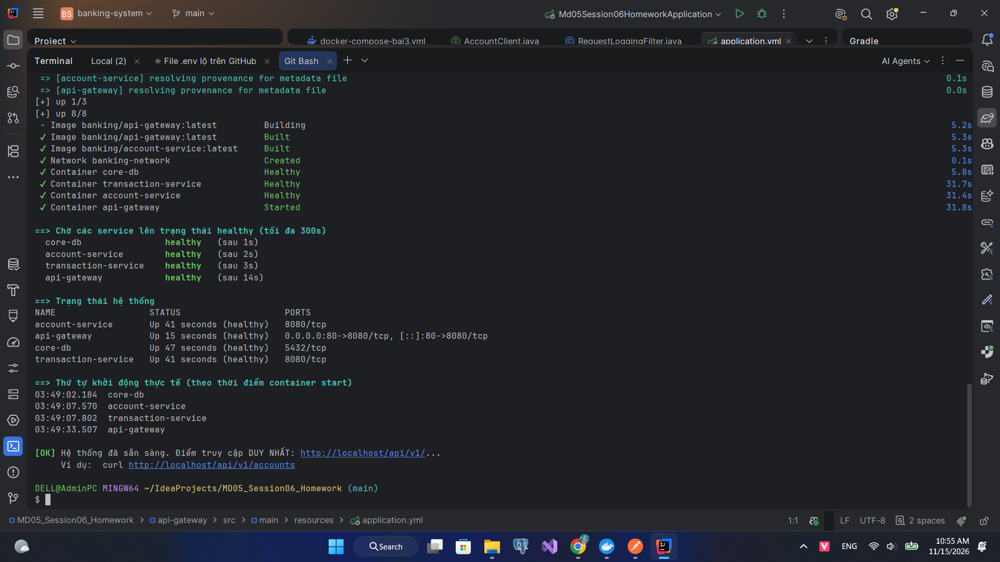 |

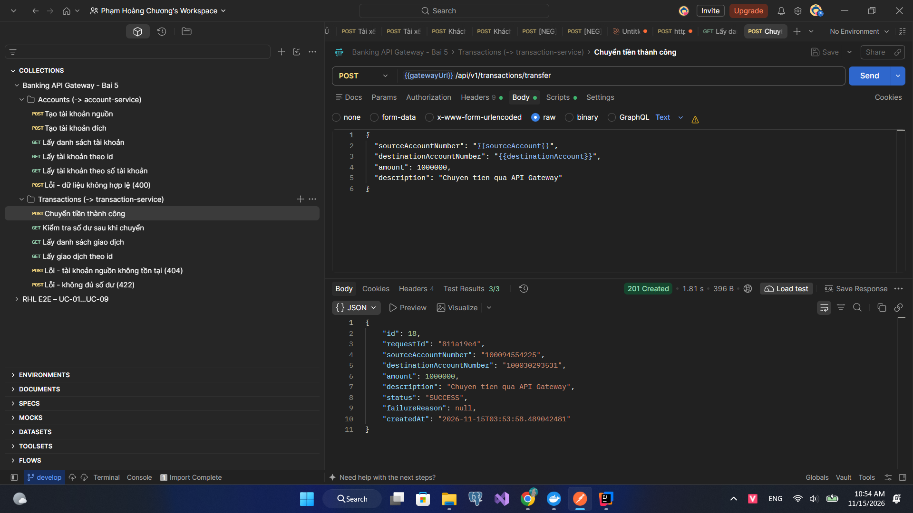

### Chạy lại từng bài

Các bài 1-5 vẫn chạy được riêng bằng file compose của bài đó:

```bash
docker compose --env-file .env -f docker-compose-bai4.yml up -d --build
```

Các file compose dùng chung tên container, nên cần tắt bài đang chạy trước khi chạy bài khác.

## Vận hành

```bash
docker compose ps                  # trạng thái các service
docker compose logs -f api-gateway # xem log một service
docker compose down                # tắt hệ thống (GIỮ dữ liệu)
docker compose down -v             # ⚠️ tắt VÀ XÓA toàn bộ dữ liệu
```

**Truy vết một request:** mọi response đều có header `X-Request-Id`. Dùng mã này để tìm log của request đó ở cả 3 service:

```bash
docker logs api-gateway 2>&1         | grep "rid=<mã>"
docker logs transaction-service 2>&1 | grep "rid=<mã>"
docker logs account-service 2>&1     | grep "rid=<mã>"
```

**Lưu ý:**
- File `.env` chứa mật khẩu database và **không được commit**, vì đã nằm trong `.gitignore`. Chỉ commit file mẫu `.env.example`.
- Nếu máy đã cài sẵn PostgreSQL thì cổng 5432 có thể vẫn hiện là "mở". Đó là PostgreSQL của máy, không phải `core-db` trong Docker.
- Muốn chạy test `contextLoads` của account-service thì cần có database đang chạy. Docker build bỏ qua test (`-x test`).
